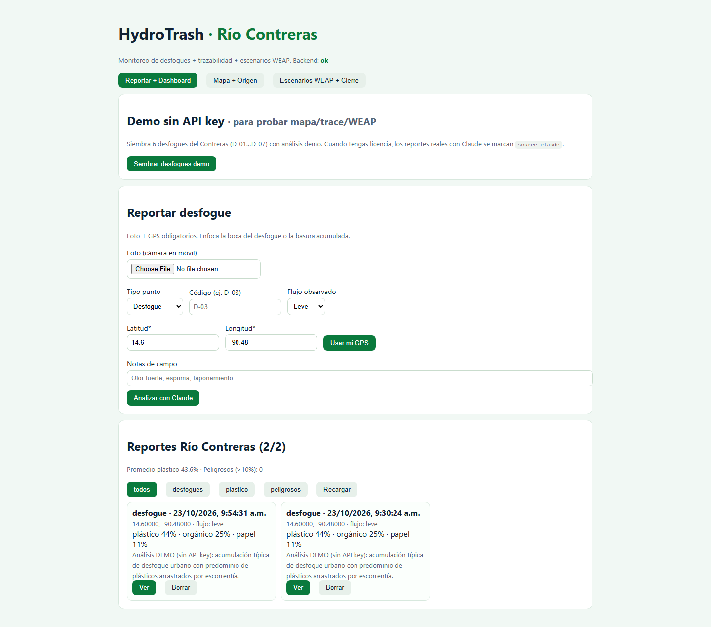
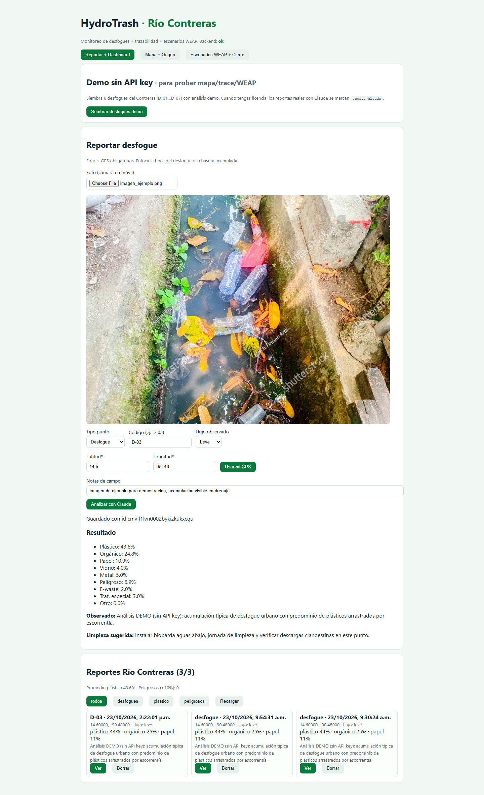
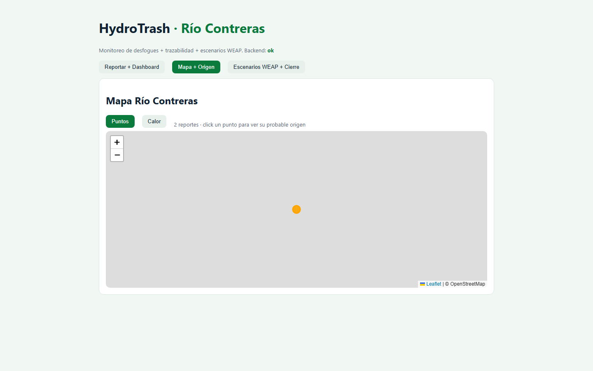
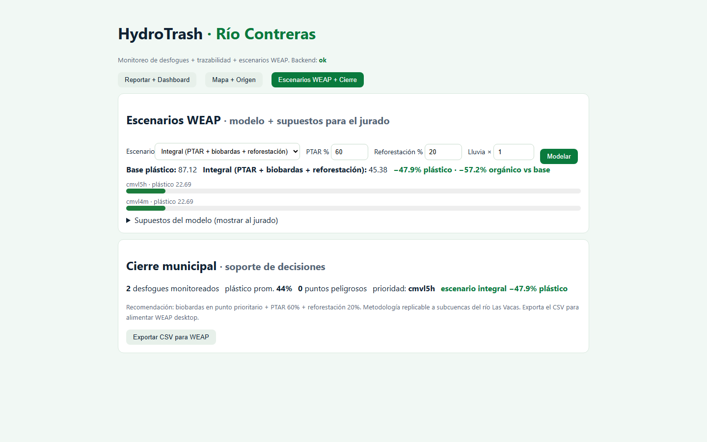

# HydroTrash · Río Contreras

API for trash detection (Claude 3.5 Sonnet), geographic storage (Turso or SQLite), optional Cloudinary for images, pre-aggregated heat maps, and GeoJSON routes. See **AGENTS.md** for full conventions.

HydroTrash registra reportes fotográficos de desfogues y tramos del río Contreras, analiza la basura visible con Claude, muestra los puntos en mapa y permite contrastar resultados hidrológicos con WEAP Desktop.



## Funcionalidades principales

- Reportes con fotografía, coordenadas GPS, tipo de punto, flujo y notas de campo.
- Clasificación de vidrio, plástico, papel, orgánico, metal, e-waste, peligroso y tratamiento especial.
- Mapa de puntos y mapa de calor con Google híbrido, Google satélite y OpenStreetMap.
- Revisión humana del análisis, conservando el resultado original de la IA.
- Exportación de reportes a CSV desde el dashboard.
- Trazabilidad de posibles fuentes aguas arriba.
- Integración de solo lectura con WEAP Desktop mediante COM en Windows.
- Interfaz responsive optimizada para celulares y trabajo de campo.
- Navegación simplificada para usuarios finales, sin indicadores técnicos del servidor.

### Capturas

| Reportes y análisis | Mapa del río | Escenarios WEAP |
|---|---|---|
|  |  |  |

### Clasificación visible de residuos

La aplicación conserva los nombres técnicos de los campos para mantener la compatibilidad de los datos, pero muestra etiquetas más claras para las personas usuarias:

| Campo de análisis | Etiqueta en la aplicación |
|---|---|
| `plasticPercentage` | Desechos plásticos |
| `organicPercentage` | Desechos orgánicos |
| `paperPercentage` | Residuos celulósicos flotantes (Papeles y cartón que aún navegan) |
| `glassPercentage` | Desechos o residuos de vidrio |
| `metalPercentage` | Desechos metálicos industriales y de aluminio (latas) |
| `eWastePercentage` | Desechos electrónicos |
| `hazardousPercentage` | Peligrosos |
| `specialTreatmentPercentage` | Productos químicos |
| `otherPercentage` | Otros residuos |

El análisis se limita a los residuos visibles en la fotografía. La revisión humana permite confirmar el resultado sin eliminar el análisis original.

### Experiencia en celular

- El formulario se adapta a una sola columna.
- Los campos de cámara, GPS, ubicación y notas ocupan el ancho disponible.
- Los botones tienen un área táctil amplia.
- Los reportes se muestran como tarjetas fáciles de leer.
- El mapa y sus controles se ajustan a pantallas pequeñas.
- Las notas de campo son opcionales.

El flujo recomendado desde un celular es: **tomar fotografía → usar GPS → seleccionar el punto observado → indicar el caudal → guardar reporte**.

---

## How to run everything

### Prerequisites

- **Node.js 20+** and **npm**
- **Anthropic API key** for image analysis — get one at [console.anthropic.com](https://console.anthropic.com/)

### 1. Install dependencies

```bash
npm install
```

### 2. Configure environment

```bash
cp .env.example .env
```

Edit `.env` and set at least:

| Variable | Required | Description |
|----------|----------|-------------|
| `ANTHROPIC_API_KEY` | **Yes** | API key from [console.anthropic.com](https://console.anthropic.com/) (needed for `POST /api/analyze-image`) |
| `DATABASE_URL` | No | Default `file:./dev.db` for local SQLite |
| `TURSO_DATABASE_URL` | No | If set with `TURSO_AUTH_TOKEN`, app uses Turso instead of SQLite |
| `TURSO_AUTH_TOKEN` | No | From [turso.tech](https://turso.tech) when using Turso |
| `CLOUDINARY_*` | No | Cloud name, API key, API secret from [cloudinary.com/console](https://cloudinary.com/console) to upload analyzed images |
| `PORT` | No | Server port (default `3000`) |

### 3. Set up the database

**Option A – Local SQLite (simplest)**

```bash
npx prisma generate
npx prisma migrate dev
```

**Option B – Turso (remote libSQL)**

1. Create a database at [turso.tech](https://turso.tech) and get `TURSO_DATABASE_URL` and `TURSO_AUTH_TOKEN`.
2. In `.env`, set those two variables. Keep `DATABASE_URL="file:./dev.db"` so Prisma CLI still works.
3. Generate the client and apply the schema manually (Prisma Migrate does not run against Turso):

   ```bash
   npx prisma generate
   npx prisma migrate diff --from-empty --to-schema-datamodel prisma/schema.prisma --script > baseline.sql
   turso db shell <your-db-name> < baseline.sql
   ```

   Re-run the SQL only when the schema changes.

**Option C – Manual SQLite (no Prisma Migrate)**

If you can’t use `prisma migrate dev`:

```bash
npx prisma generate
# From project root (creates dev.db):
sqlite3 dev.db < prisma/init.sql
```

### 4. Run the server

**Development (watch mode, auto-reload):**

```bash
npm run dev
```

**Production (build then run):**

```bash
npm run build
npm start
```

Server base URL: **http://localhost:3000** (or the `PORT` you set).

### 5. Verify it’s running

- Open or request: **http://localhost:3000/health**  
  You should see: `{ "status": "ok" }`.

---

## API

- **POST `/api/analyze-image`**  
  Body: `multipart/form-data` with `image` (file) and **required** `latitude`, `longitude` (numbers).  
  Response: `{ trash: TrashAnalysis, id: string }`.  
  TrashAnalysis includes: glass, plastic, paper, organic, metal, other, **eWaste**, **hazardous**, **specialTreatment** percentages, plus `description` and `suggestedCleanup`.  
  A record is always saved (coordinates required). If Cloudinary is configured, the image is uploaded and `imageUrl` is stored.

- **GET `/api/trash`**  
  Returns all trash records (id, createdAt, lat/lng, all percentages, description, suggestedCleanup, imageUrl, source).

- **GET `/api/trash/:id`**  
  Returns one trash record by id. 404 when not found.

- **DELETE `/api/trash/:id`**  
  Deletes the trash record. 204 on success, 404 when not found.

- **GET `/api/heatmap?precision=5`**  
  Pre-aggregated data for heat maps. Returns `{ precision, buckets }` (geohash buckets with count and waste-type totals). `precision` 4–7, default 5.

- **GET `/api/routes/optimized`**  
  Returns a GeoJSON `FeatureCollection` (MVP: empty). Future: optimized collection route as LineString(s).

- **GET `/health`**  
  `{ "status": "ok" }`

---

## Frontend: displaying the optimized route (GeoJSON)

When the backend returns a route as GeoJSON (e.g. a `FeatureCollection` with LineString features):

- **Leaflet**: `L.geoJSON(geojson).addTo(map)` — [Leaflet GeoJSON](https://leafletjs.com/reference.html#geojson)
- **Mapbox GL JS**: `map.addSource('route', { type: 'geojson', data: geojson })` and add a line layer — [Mapbox GeoJSON](https://docs.mapbox.com/mapbox-gl-js/example/data-driven-circle-colors/)
- **deck.gl**: `GeoJsonLayer` — [deck.gl GeoJsonLayer](https://deck.gl/docs/api-reference/layers/geojson-layer)

---

## Tests

- **Run tests**: `npm test` (uses `test.db`, runs migrations then Vitest).
- **Watch mode**: `npm run test:watch`.

Covers: health, GET/POST/DELETE trash, GET trash by id, heatmap, routes/optimized, analyze-image validation (400 when image or coordinates missing).

---

## Other useful commands

| Command | Description |
|--------|-------------|
| `npm run dev` | Start dev server with watch |
| `npm run build` | Compile TypeScript to `dist/` |
| `npm start` | Run compiled app (after `npm run build`) |
| `npm test` | Run tests (Vitest) |
| `npm run test:watch` | Run tests in watch mode |
| `npx prisma studio` | Open Prisma Studio to inspect/edit DB |

---

## Tech

- Node.js, TypeScript, Express
- Prisma with **Turso** (libSQL adapter) or SQLite
- **Cloudinary** (optional) for images
- Anthropic SDK (Claude 3.5 Sonnet)
- ngeohash for heat map aggregation

## Frontend

En otra terminal:

```bash
cd frontend
npm install
npm run dev
```

La interfaz se abre normalmente en `http://localhost:5173`.

## Flujo recomendado de uso

1. Registra un desfogue o tramo de río con fotografía y GPS.
2. Revisa el resultado generado y confirma el análisis desde el detalle.
3. Consulta los reportes en el dashboard o visualízalos en el mapa.
4. Usa **Descargar datos CSV** para exportar los registros cargados.
5. Ejecuta WEAP y compara/importa sus resultados mediante el puente.

## Integración con WEAP Desktop

El puente COM funciona en Windows con WEAP instalado y abierto. Es de solo lectura: no modifica el área, no cambia escenarios y no ejecuta cálculos.

```powershell
py -m venv .venv
.\.venv\Scripts\Activate.ps1
py -m pip install -r weap-bridge\requirements.txt
Copy-Item weap-bridge\config.example.json weap-bridge\config.json
```

Edita `weap-bridge/config.json` con los nombres exactos del área, escenario, rama, variable y unidad de WEAP. Este archivo es local y está excluido de Git.

Con WEAP abierto y el área activa:

```powershell
python weap-bridge/weap_com_bridge.py --config weap-bridge/config.json diagnose
python weap-bridge/weap_com_bridge.py --config weap-bridge/config.json extract-one --output resultados.csv
python weap-bridge/weap_com_bridge.py --config weap-bridge/config.json import resultados.csv
```

Los resultados importados se consultan en `GET /api/weap/runs`. El endpoint `/api/weap/results?scenarioId=integral` corresponde a los escenarios internos del adaptador HydroTrash; no se debe usar con nombres de WEAP como `Reference`.

Consulta la guía específica en [`weap-bridge/README.md`](weap-bridge/README.md).
